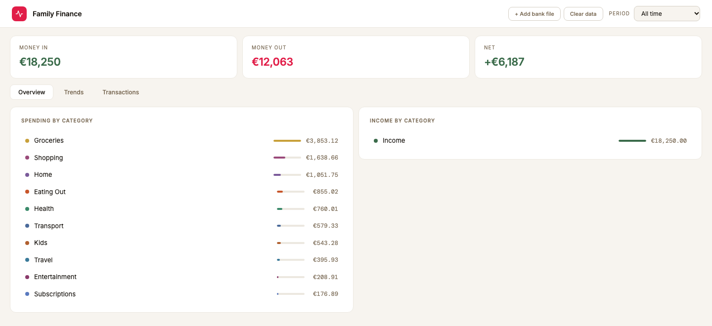
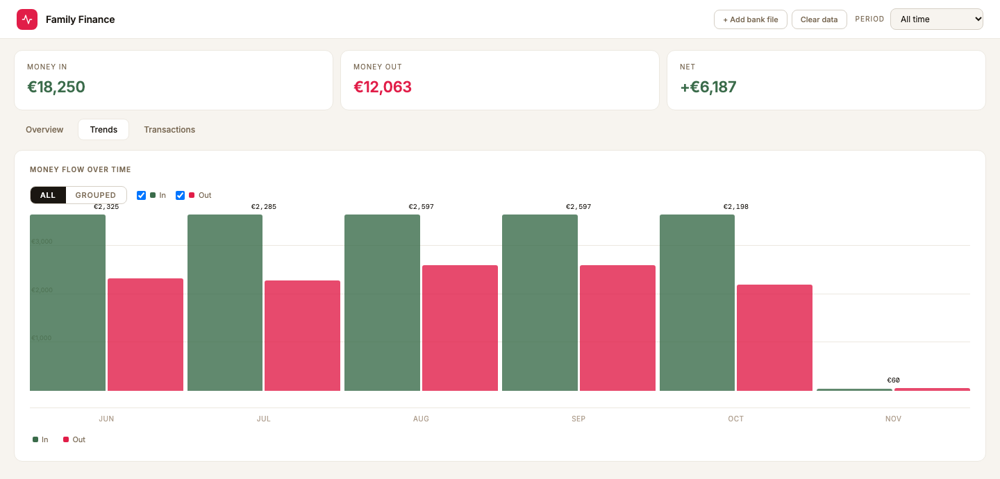
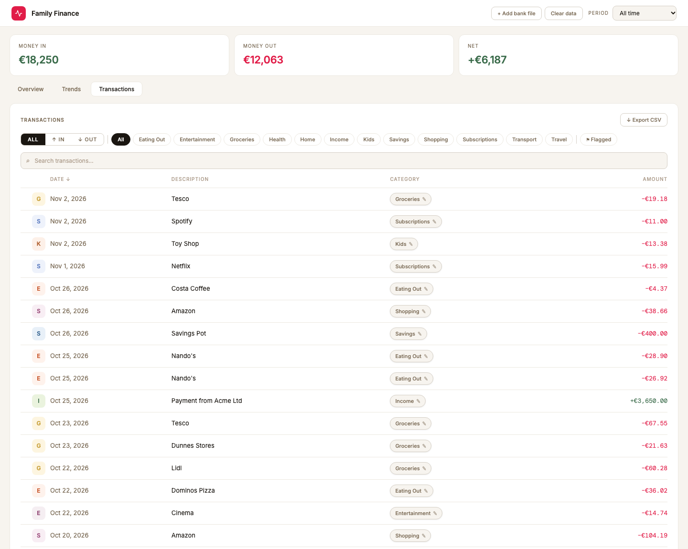

# Family Finance

A lightweight, single-page finance tracker for Revolut and Bank Hapoalim exports. No accounts and no server of its own: your transactions stay in your browser.

**Live app → [avitalboas-dev.github.io/family-finance](https://avitalboas-dev.github.io/family-finance/)**



<sub>Screenshots use made-up demo data.</sub>

---

## How it works

1. Export your bank data (Revolut CSV or Bank Hapoalim Excel)
2. Drop the file onto the upload screen
3. Add more files from either bank using the **+ Add bank file** button in the top bar
4. Switch between sources with the **All / Revolut / Hapoalim** toggle

---

## Features

**Overview tab**
- Spending breakdown by category with bar chart
- Income breakdown by category
- Click any category row to jump to the Transactions tab filtered by that category

**Trends tab**
- Monthly flow chart showing income vs. spending over time
- Category trend chart — month-by-month spending for a selected category



**Transactions tab**
- Full sortable table — click any column header to sort by date, description, category, or amount
- Direction filter: All / ↑ In / ↓ Out
- Category filter pills — click to filter, click again to deselect
- Flag filter — flag transactions for review with ⚑
- Search across description, category, date, and amount
- Pagination with configurable rows per page (10 / 25 / 50 / 100) and "Showing x–y of z" summary
- Category editor — reassign any transaction's category; click the category tag to edit
- "↗ View trend" shortcut button appears when a category filter is active

**Top bar**
- Period selector (last 3 months default; also last 6 months, all time, individual months, custom range) — always on the far right
- Source switcher (All / Revolut / Hapoalim) — period selection is preserved when switching
- **+ Add bank file** and **Clear data** — visible after first upload



---

## Supported file formats

| Bank | Format | Export path |
|------|--------|-------------|
| Revolut | CSV | App → Statements → CSV |
| Bank Hapoalim | Excel (.xlsx) | Online banking → Account activity → Export |

---

## Data & persistence

| What | Where | Scope |
|------|-------|-------|
| Transactions | Browser `localStorage` | Per device — each person uploads their own files |
| Category mappings | [JSONBin.io](https://jsonbin.io) | Shared — syncs automatically across all devices |

Category edits save to JSONBin instantly on every change and are loaded on startup. No manual export needed.

**Privacy:** your bank files are read in the browser and never uploaded. Only category mappings (a merchant name and the category you chose for it) are sent to JSONBin.

**About the hosted app:** the live version syncs category edits to the author's own JSONBin store, so changes made there are shared with that store. To keep your categories to yourself, fork the repo and point `index.html` at your own JSONBin bin (search for `jsonbin`), or run it locally.

---

## Local development

No build step needed. Just open `index.html` in a browser.

```bash
# Serve locally (avoids fetch restrictions on file:// URLs)
npx serve .
```

---

## Deployment

Deployed via GitHub Pages from the `main` branch root. Any push to `main` updates the live site within a minute or two.
